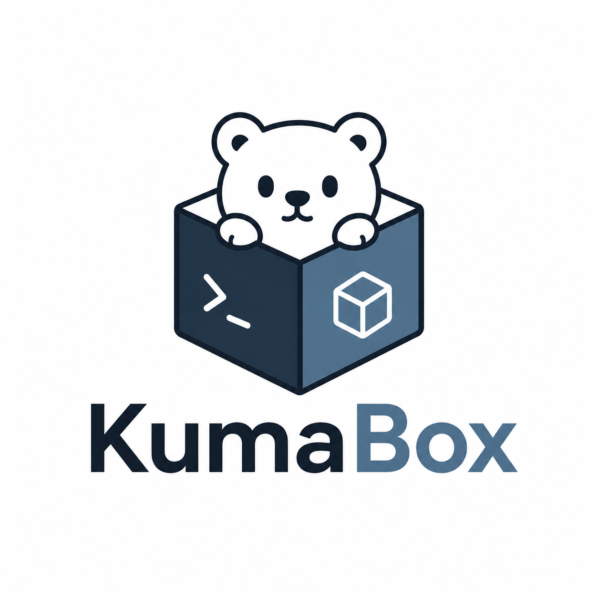

<p align="center">
  
</p>

<p align="center">A Linux microVM runtime for AI agents.</p>
<p align="center"><b>English</b> · <a href="README.zh-CN.md">简体中文</a></p>
<p align="center">
  <a href="https://github.com/kgpp34/KumaBox/actions/workflows/ci.yml"></a>
  <a href="LICENSE"></a>
</p>

KumaBox runs agent workloads in KVM-isolated microVMs backed by Cloud Hypervisor.
It manages images, sandbox lifecycle, guest operations, networking, storage and
snapshots on a single host, through a CLI and HTTP API.

## Capabilities

| Area | Supported operations |
| --- | --- |
| Images | Pull from registries; import Docker archives and OCI layouts or archives; verify, inspect and remove images. |
| Sandboxes | Create, run, start, stop and remove; configure CPU, memory and storage; query state and logs. |
| Guest operations | Execute commands, manage background processes, transfer files, attach a console and forward ports. |
| Snapshots | Save, restore, clone and hibernate; export and import snapshots for transfer between compatible hosts. |
| Networking | TAP/eBPF networking with fixed guest identity and reusable TAP devices; CNI and Linux bridge backends. |
| Storage and devices | Persistent writable root disks, data disks, virtio-fs directory sharing and VFIO PCI passthrough. |
| Resources | cgroup controls, hugepages, KSM and memory ballooning. |

## Benchmarks

### Runtime lifecycle

Archived native-guest measurements from October 29–30, 2026, on a **Xeon
E3-1245 v2** (4 cores / 8 threads, 32 GiB RAM, SATA SSD RAID1, XFS), using
Cloud Hypervisor v54 with mmap restore.

Each VM has 2 vCPUs, 512 MiB RAM and a 10 GiB buffered writable disk. The guest
uses the native Rust PID 1 profile; NIC tests use TAP/eBPF. Clone tests use
`machine_id_sync: false`.

Latency runs from CLI invocation to the first successful guest `/bin/true`.
All values are in milliseconds; concurrent rows report per-request latency.

| Operation | NICs | p50 | p95 | Samples |
| --- | ---: | ---: | ---: | ---: |
| Cold boot | 0 | 239.4 | 260.6 | 30 |
| Cold boot | 1 | 253.5 | 280.6 | 30 |
| Golden snapshot clone | 0 | 64.1–66.4 | 69.6–70.4 | 2 × 24 |
| Golden snapshot clone | 1 | 61.9–65.2 | 67.8–70.5 | 2 × 24 |
| In-place restore | 0 | 58.8 | 68.2 | 30 |
| In-place restore | 1 | 60.5 | 66.5 | 30 |
| 16 concurrent golden clones | 0 | 260.5–268.1 | 311.8–319.8 | 2 × 96 |
| 16 concurrent golden clones | 1 | 399.0–415.6 | 485.9–1105.9 | 2 × 96 |

Cold boot and restore results are from October 29; TAP-pool clone results are
from October 30. Ranges show the separate percentiles from two runs, not pooled
percentiles. Each concurrent run contains six batches of 16 requests.

Images and golden snapshots were prepared beforehand. Host page cache was kept
warm; DNS/Internet readiness is outside the timing endpoint. No VM warm pool was
used. These measurements describe the stated builds and configuration.

### Warm-pool claims (KumaBoxd)

On November 1, 2026, [KumaBoxd](https://github.com/kgpp34/KumaBoxd) was measured
on the same Xeon host, with 16 ready VMs, each with 2 vCPUs, 512 MiB RAM, a
10 GiB writable disk and one eBPF NIC.

| Durability | Claim load | p50 (ms) | p95 (ms) | Samples |
| --- | --- | ---: | ---: | ---: |
| `sync` (default) | Serial | 0.891 | 1.745 | 480 |
| `sync` (default) | 16 concurrent | 3.609 | 6.484 | 480 |
| `buffered` | Serial | 0.230 | 0.543 | 480 |
| `buffered` | 16 concurrent | 1.714 | 3.526 | 480 |

Each row pools requests from three interleaved rounds of 10 batches × 16 claims.
Timing includes request encoding, loopback HTTP/1.1 and response decoding.
VM preparation, refill and subsequent guest commands are outside this endpoint;
claimed VMs were checked with `/bin/true` after claim timing stopped.

`sync` acknowledges a synchronous bbolt commit. `buffered` acknowledges a journal
append to the OS cache and checkpoints asynchronously; host failure can lose
recently acknowledged changes.

## Architecture

CLI commands submit operations to a resident `kumabox daemon` over a local Unix
socket. The daemon owns the metadata store, coordinates resource operations and
supervises VMM processes. `kumabox serve` provides an authenticated HTTP API.
Metadata is stored locally in SQLite.

Each sandbox has a dedicated guest kernel and VMM process. Read-only EROFS image
layers are shared; each sandbox has a private writable ext4 disk. The Rust guest
init assembles the root filesystem and supervises the Go agent, which handles
guest commands and file operations over vsock.

[KumaBoxd](https://github.com/kgpp34/KumaBoxd) builds on this runtime to manage
node-local templates, warm pools and sandbox leases.

## Getting started

Running sandboxes requires Linux, KVM (`/dev/kvm`) and root privileges. Download
host tools and the matching guest image from
[Releases](https://github.com/kgpp34/KumaBox/releases).
Guest images must include compatible boot artifacts and the KumaBox agent.

To build from source, use Go 1.24.4 or newer:

```bash
make build
sudo ./bin/kumabox-check --upgrade
sudo ./bin/kumabox daemon
```

With the daemon running, import a compatible guest image archive in another
terminal and create a sandbox:

```bash
sudo ./bin/kumabox image import demo-image /path/to/guest-image.tar
sudo ./bin/kumabox run demo-image --name demo --cpus 2 --memory 512MiB --nics 0
sudo ./bin/kumabox exec demo -- uname -a
sudo ./bin/kumabox snapshot save demo --name golden
sudo ./bin/kumabox clone golden --name demo-copy
```

The example runs without networking. Use `kumabox --help` and
`kumabox COMMAND --help` for command options. A
[systemd unit](packaging/systemd/kumabox.service) is included for service deployment;
`make guest` builds the native guest image using Docker.

## API and SDKs

The [Python and TypeScript SDKs](sdk/README.md) use the versioned HTTP API.
The [E2B adapter](internal/api/e2b/README.md) is experimental and implements a
subset of the protocol.

## License

[MIT](LICENSE)
