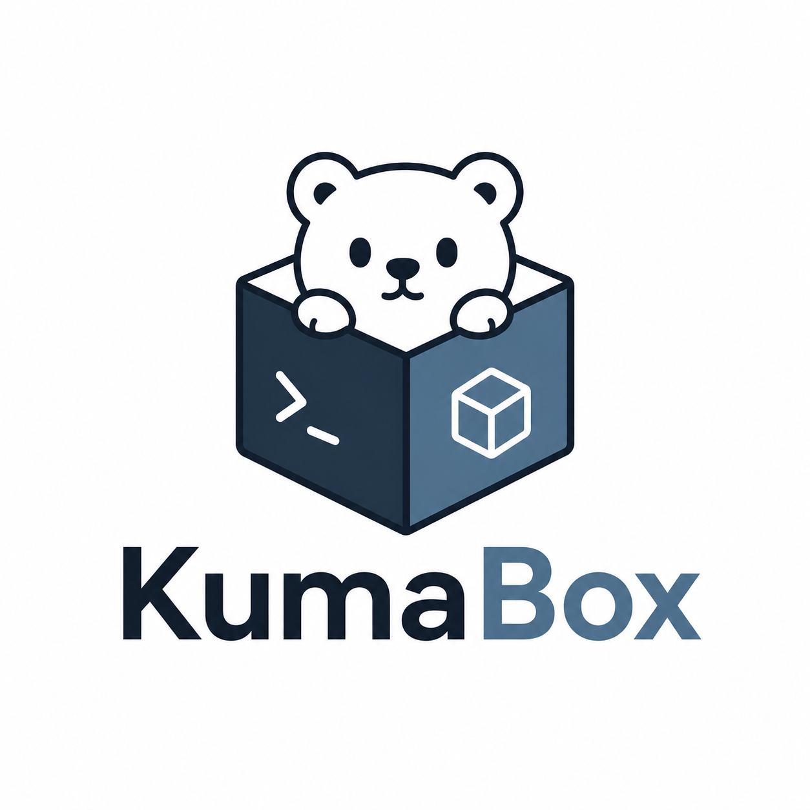

<p align="center">
  
</p>
<p align="center"> <b>English</b> · <a href="./README.zh-CN.md">简体中文</a> </p>
<p align="center">
  <a href="https://github.com/kgpp34/KumaBox/actions/workflows/ci.yml"></a>
  
  
  <a href="LICENSE"></a>
  <a href="https://github.com/kgpp34/KumaBox/stargazers"></a>
  <a href="https://github.com/kgpp34/KumaBox/network/members"></a>
</p>

<p align="center">
  <a href="#quick-start">Quick start</a> ·
  <a href="#architecture">Architecture</a> ·
  <a href="#how-kumabox-compares">Comparison</a> ·
  <a href="#roadmap">Roadmap</a>
</p>

AI agents write code, install packages, open network connections and touch
files nobody reviewed. Running that on a shared kernel is a bet. KumaBox gives
every task its own **KVM microVM** with its own kernel, disk and network
namespace, and gets you from an OCI image to a running sandbox in one command.

> [!NOTE]
> v0.1.0 is the first regular release of the single-host runtime. KumaBox is still
> in the 0.x series; review release notes and snapshot compatibility before
> upgrading. The E2B protocol adapter remains experimental.

## What KumaBox is

<p align="center"></p>

KumaBox is a **microVM sandbox runtime for AI agents and untrusted
workloads**. It handles images, VM lifecycle, networking, snapshots and
guest execution end to end, so you work with sandboxes rather than raw VMMs.
Anything that can run a command can drive it today: a coding agent, an agent framework's tool call,
an RL or eval harness fanning out thousands of attempts, a CI job, or you at a
terminal.

Each sandbox is a real machine:

- **Hardware isolation.** A dedicated guest kernel behind KVM, with one Cloud Hypervisor process per VM.
- **OCI in, microVM out.** Digest-pinned OCI images become shared, read-only EROFS layers plus a private copy-on-write disk per VM.
- **Real networking.** CNI namespaces, direct Linux bridges, or experimental isolated TAP/eBPF networking, with multiple NICs and live resize.
- **Guest execution without SSH.** `exec` over vsock with streamed stdout and stderr, optional stdin, environment, working directory and guest user. Detached commands remain manageable after disconnect through `process ls/kill/logs/attach`.
- **Snapshots as first-class artifacts.** Save a running VM, restore or hibernate it, clone it with a fresh network identity, or export and import it as a portable archive.
- **Runtime devices.** Attach external raw disks, virtio-fs shares and VFIO PCI devices to a running Cloud Hypervisor VM.
- **Built to be scripted.** Lifecycle commands offer JSON output and `inspect` returns indented JSON.

## Architecture

<p align="center"></p>

**Persistent node runtime.** CLI commands submit requests over an owner-only Unix
socket to `kumabox daemon`. The daemon owns one shared application and metadata
engine, runs operations concurrently under resource locks, and supervises VM exits.
`kumabox serve` exposes the node through the authenticated public HTTP API. Each running VM
is backed by its own Cloud Hypervisor process, so one sandbox can never take
down another.

**Durable lifecycle.** SQLite records sandbox and snapshot states. Operations
stage artifacts privately, publish complete results, and retain ownership when
cleanup must be retried.

| Path | Purpose |
| --- | --- |
| `/var/lib/kumabox` | Images, VM records, snapshots, network leases, content |
| `/run/kumabox` | PID files, API sockets, operation locks |
| `/var/log/kumabox` | VM and runtime logs |

## Warm once, fork many

<p align="center"></p>

Agents retry, branch and explore. Pay the setup cost once: boot, install
dependencies, warm caches. Capture a **running snapshot** of memory and disks,
then `clone` it for every attempt. Each clone gets a private writable disk,
network identity and hostname. Cloud Hypervisor v53 can use opt-in on-demand
memory restore; newer compatible versions can use copy-on-write memory restore.

## Quick start

You need Linux amd64 or arm64 with `/dev/kvm`, and root.

Preview releases provide a Linux amd64 archive containing `kumabox` and
`kumabox-check`, plus a matching Ubuntu guest image. Download the archive and
`SHA256SUMS` from the [GitHub release](https://github.com/kgpp34/KumaBox/releases),
verify them with `sha256sum -c SHA256SUMS`, then extract and install both files.
Use the guest image tag named in that release; host and guest artifacts must
come from the same version. The source-build path below remains available.

```bash
# 1. Build and install
git clone https://github.com/kgpp34/KumaBox.git && cd KumaBox
make build
sudo install -m 0755 bin/kumabox /usr/local/bin/kumabox
sudo install -m 0755 bin/kumabox-check /usr/local/bin/kumabox-check

# 2. Prepare the host once: Cloud Hypervisor, firmware, CNI plugins, EROFS tools
sudo kumabox-check --upgrade
sudo install -m 0644 packaging/systemd/kumabox.service /etc/systemd/system/kumabox.service
sudo systemctl daemon-reload
sudo systemctl enable --now kumabox
sudo kumabox doctor

# 3. Pull the published guest image
sudo kumabox image pull ghcr.io/kgpp34/kumabox/ubuntu:24.04

# 4. Run a sandbox and talk to it
sudo kumabox create ghcr.io/kgpp34/kumabox/ubuntu:24.04 --name my-vm --cpus 2 --memory 1GiB --storage 10GiB
sudo kumabox start my-vm
sudo kumabox exec my-vm -- uname -a

# 5. Warm once, fork many
sudo kumabox snapshot save my-vm --name base
sudo kumabox clone base --name fresh
sudo kumabox net fresh --configure
sudo kumabox exec fresh -- hostname
sudo kumabox snapshot export base --output base.tar

# 6. Clean up
sudo kumabox stop fresh
sudo kumabox stop my-vm
sudo kumabox rm fresh
sudo kumabox rm my-vm
sudo kumabox snapshot rm base
sudo kumabox image remove ghcr.io/kgpp34/kumabox/ubuntu:24.04
```

`stop` requests ACPI guest shutdown and waits up to 30 seconds by default.
Use `stop my-vm --timeout 10` to set that window in seconds, or
`stop my-vm --force` to skip it. `--timeout 0` uses `sandbox.stop_timeout`
(also configurable through `KUMABOX_SANDBOX_STOP_TIMEOUT`, e.g. `10s`).
If the guest ignores ACPI or exceeds its window, the runtime force-terminates
the owned VMM with TERM, then KILL after `vmm.cloud_hypervisor.stop_grace`.
Guest power-event handling must be ready for a normal shutdown; agent readiness
alone does not prove that. Cancelling stop retains a retryable state rather than
escalating after cancellation; retry with `stop --force` if necessary.
Writable root and managed data disks survive stop/start without a snapshot.
Force termination can lose guest writes that have not reached disk. Restore,
hibernate, HTTP deletion and E2B kill/expiry cleanup explicitly skip the guest
shutdown window; they do not incur a new 30-second wait.

Both `clone` and `restore` accept `--restore-mode auto|copy|ondemand|mmap`.
Automatic selection uses mmap when the monitor and captured memory support it,
otherwise eager copy. On-demand paging is opt-in to avoid first-touch tail
latency under the runtime CPU ceiling. Explicit lazy modes require a compatible
monitor. Hugepage or shared backing falls back from mmap to eager copy; ondemand
requires plain private memory. These checks run before stopping a restore target.
During restore, the VMM loads memory without the guest CPU ceiling; the normal
ceiling is applied before the guest resumes.

Directories supplied with `--from-dir` must be immutable: do not overwrite their
files while they are in use. Same-filesystem clones share immutable memory files
by hard link while keeping writable disks and configuration private. A
cross-filesystem transfer copies the memory instead.

`clone` returns after the VM resumes. Run `net SANDBOX --configure` to apply
the clone's hostname and allocated NIC settings in the guest, or use
`clone --wait-network` to include that step before the command returns. The
default path renews guest entropy and machine ID in a detached process.

Host and guest artifacts are a matched release pair. Pin a versioned guest tag
such as `24.04-v0.1.0`, or an OCI digest, when reproducibility matters.
`sudo kumabox-check` alone performs a read-only host audit.

### CPU scheduling and guest memory

`create` and `run` accept host CPU policy separately from `--cpus` (guest topology):

```bash
sudo kumabox create ghcr.io/kgpp34/kumabox/ubuntu:24.04 --name limited \
  --cpus 2 --cpu-weight 100 --cpu-quota-us 150000 --cpu-period-us 100000 \
  --cpu-burst-us -1 --cpuset-cpus 2-3
```

The example grants 150ms of CPU time per 100ms window across host CPUs 2 and 3,
with no saved burst credit. CPU IDs must belong to the host's effective cpuset;
this is explicit placement, not automatic pinning. Defaults are weight = vCPU
count, period = 100000us, quota = vCPU count × period, and burst credit = quota.
This changes the previous strict default: use `--cpu-burst-us -1` to disable
bursting. Old kernels without burst support degrade the derived default only;
explicit positive burst settings require kernel support. `clone` accepts the same CPU
flags and derives fresh defaults, never inheriting a source-host cpuset. Restore
keeps the target policy; its weight and placement apply during memory loading,
and its quota and burst apply before the guest resumes.

Memory options are fixed at creation and inherited by snapshots and clones:

| Flag | Behavior |
| --- | --- |
| `--hugepages` | Uses a host hugetlb pool reserved by the operator. Insufficient pages fail launch; snapshot memory restores by eager copy, including explicit mmap requests. |
| `--mergeable` | Marks private guest RAM for KSM. Cannot combine with hugepages or shared memory. The operator must enable and tune the host KSM scanner; the runtime does not change it. |
| `--no-balloon` | Omits the balloon device. Otherwise the initial balloon target reclaims 25% of configured RAM, with deflate-on-OOM and free-page reporting enabled. |

Before snapshot capture, the guest gets time to settle its balloon target while
still running. Reclaim that makes no progress for 2 seconds (or exceeds 1 minute
overall) logs a warning and capture continues with the current memory. These
options trade CPU work, memory density and restore latency; they are not
unconditional performance improvements. The HTTP create endpoint accepts
`cpu_policy`, `hugepages`, `mergeable` and `no_balloon` as JSON fields.

### Share a host directory with virtio-fs

Create the sandbox with `--shared-memory`; this VM setting cannot be enabled
after creation. On Ubuntu 24.04, install the `virtiofsd` package and start its
server for the directory you want to share:

```bash
sudo apt-get install virtiofsd
sudo install -d /tmp/kumabox-share
sudo /usr/libexec/virtiofsd --socket-path=/tmp/kumabox-share.sock \
  --shared-dir=/tmp/kumabox-share --cache=never &

sudo kumabox run ghcr.io/kgpp34/kumabox/ubuntu:24.04 \
  --name share-vm --shared-memory
sudo kumabox fs attach share-vm --socket /tmp/kumabox-share.sock --tag data
sudo kumabox fs list share-vm --json
sudo kumabox exec share-vm -- sh -c \
  'mkdir -p /mnt/data && mount -t virtiofs data /mnt/data && echo hello >/mnt/data/hello'
sudo cat /tmp/kumabox-share/hello

sudo kumabox exec share-vm -- umount /mnt/data
sudo kumabox fs detach share-vm --tag data
sudo kumabox stop share-vm
sudo kumabox rm share-vm
```

`fs list` and `inspect` report live attachments. A share lasts only for the
current VM process; after stop or restart, start a fresh `virtiofsd` and attach
again. Unmount and detach it before `snapshot save` or `hibernate`.

### Background commands

These commands require a guest image containing the updated `kumabox-agent`;
upgrading only the host binary does not upgrade an existing guest. Older agents
reject execution options they cannot honor instead of silently ignoring the
requested user or working directory.

```bash
sudo kumabox exec --cwd /tmp --user root my-vm -- pwd
process_id=$(sudo kumabox exec --detach --cwd /tmp my-vm -- sh -c \
  'echo started; sleep 10; echo finished')
sudo kumabox process ls my-vm --json
sudo kumabox process logs my-vm "$process_id"
sudo kumabox process attach my-vm "$process_id"
sudo kumabox process ls my-vm --all --json
```

`process attach` replays retained output and follows until the command exits;
Ctrl-C detaches without killing it. `process kill my-vm "$process_id"` sends
TERM; `--signal KILL` forces termination. On Linux signals target the command's
process group. Background stdin is closed, and attach is output-only, not a PTY.
When the command exits, remaining members of its process group are terminated.
Use an existing guest username or UID with `--user`; this does not create users.

Each guest agent allows 64 running background commands and retains at most 128
process records, evicting the oldest exited records when needed. Each command
retains up to 256 KiB / 256 output frames; overwritten output is reported
explicitly. These records are in guest memory, not a durable host task database.
Graceful agent shutdown terminates its commands; a restart clears the table. If a
spawn response is lost, list commands before retrying: the command may already
be running. SDK and HTTP process-management endpoints are not included yet.

### Forward a guest service

`forward` connects a host loopback TCP port to `127.0.0.1` inside a running
sandbox through vsock. It works with `--nics 0` as well as networked guests.
For example, with Python installed in the guest:

```bash
sudo kumabox exec --detach my-vm -- python3 -m http.server 8000 --bind 127.0.0.1
sudo kumabox forward my-vm 8080:8000
# In another host terminal:
curl http://127.0.0.1:8080/
```

HTTP, WebSocket and other TCP protocols pass through unchanged, including TCP
half-close. TCP writes stalled for 30 seconds close the connection; otherwise
idle connections have no timeout. Ctrl-C closes the listener and its active connections, leaving the
guest service running. A stopped VM closes active streams; the listener stays
available for the same sandbox ID after restart. Removing and recreating a
sandbox under the same name does not redirect an existing forward to the new VM.

Use `0:8000 --json` to allocate a free local port and print its address, or
`--address ::1` for an IPv6 host loopback listener. Listening is restricted to
loopback IPs, with at most 64 simultaneous connections per command. The initial
message confirms the host listener; guest-service connection errors are reported
on stderr per connection. The image must contain the updated agent. Existing
images need rebuilding or updating; replacing only the host binary is insufficient.

On a Linux/KVM test host, an image containing Python 3 and the matching agent
can run the HTTP, WebSocket, concurrency, half-close and cleanup checks with:

```bash
sudo python3 tests/e2e/port_forward.py --image my-updated-image --commit AGENT_BUILD_ID
```

### Guest files

The `file` commands require a running sandbox with the updated guest agent.
They operate through vsock, including when the sandbox has no network card.
`fs attach/detach/list` continues to manage virtio-fs shares.

```bash
sudo kumabox file mkdir my-vm /tmp/workspace --parents
printf 'print("hello from guest")\n' > /tmp/hello.py
sudo kumabox file write my-vm /tmp/workspace/hello.py /tmp/hello.py --mode 0644
sudo kumabox file ls my-vm /tmp/workspace
sudo kumabox file stat my-vm /tmp/workspace/hello.py
sudo kumabox file read my-vm /tmp/workspace/hello.py
printf 'updated\n' | sudo kumabox file write my-vm /tmp/workspace/result.txt
sudo kumabox file mv my-vm /tmp/workspace/result.txt /tmp/workspace/final.txt
sudo kumabox file rm my-vm /tmp/workspace --recursive
```

Paths must be canonical absolute guest paths. Reads stream regular files;
symlinks to regular files are followed, while directories, devices and FIFOs
are rejected. `stat` reports the symlink itself. Writes reject symlink targets,
stage in the destination directory, then atomically replace the target after a
complete transfer. Existing file permissions are preserved unless `--mode` is
set; new files default to 0600 and new directories to 0700. Replacement changes
the inode; ownership, extended attributes and hard-link relationships are not
preserved. This is not an fsync durability guarantee across guest crashes.

Transfers use bounded chunks without loading the full file into memory.
Directory listings stream batches in filesystem order; `--json` prints an array.
A nonzero exit can mean a partial read/listing. If an upload's final response is
lost, inspect the destination before retrying because it may already be committed.
Recursive removal requires `--recursive`, does not follow final symlinks, and
rejects the root directory. These operations run with the guest agent's authority
and can access mounts shared into the guest. SDK/HTTP file endpoints are unchanged.

On a Linux/KVM host, test an imported Ubuntu/systemd image containing the current agent with:

```bash
sudo python3 tests/e2e/guest_operations.py \
  --image my-updated-image --commit "$(git rev-parse --short HEAD)"
```

This creates and removes its own test sandboxes with 0 and 1 NIC. It checks file
transfers, cancelled uploads, permissions, directory batches, links, background
commands and stop/start persistence after guest `sync`. `--commit` must identify the agent build in
the image. Dedicated `--root-dir`, `--run-dir` and `--log-dir` isolate test metadata;
the image must be imported into that root first. The JSON report defaults to
`/tmp/kumabox-guest-e2e.json`.

### Drive it from an agent

`exec` streams guest output and preserves the guest command's exit code.

```python
import subprocess

def run_in_sandbox(vm: str, script: str) -> subprocess.CompletedProcess[str]:
    proc = subprocess.run(
        ["sudo", "kumabox", "exec", vm, "--", "sh", "-c", script],
        capture_output=True, text=True,
    )
    return proc

result = run_in_sandbox("fresh", "hostname")
print(result.returncode, result.stdout, result.stderr)
```

Fan out parallel attempts from one warm snapshot:

```bash
for i in $(seq 1 8); do
  sudo kumabox clone base --name try-$i &
done
wait
sudo kumabox ps
```

The published Ubuntu guest is intentionally minimal. To bake in your own
toolchain (Python, Node, browsers), extend
[`oci-images/ubuntu/Dockerfile`](oci-images/ubuntu/Dockerfile),
which already installs the matching `kumabox-agent`, kernel and initramfs.

For latency-sensitive Linux guests that do not need loadable kernel modules,
build the optional single-layer fast-boot image from the same source tree:

```bash
docker build -f oci-images/ubuntu/Dockerfile -t kumabox/ubuntu:24.04 .
docker build -f oci-images/fastboot/Dockerfile.boot -t kumabox/boot:fast .
docker build -f oci-images/fastboot/Dockerfile.image -t kumabox/ubuntu:fast .
docker save kumabox/ubuntu:fast -o /tmp/kumabox-ubuntu-fast.tar
sudo kumabox image import ubuntu-fast /tmp/kumabox-ubuntu-fast.tar --format docker
```

The fast profile has its own built-in kernel and initramfs; use the general
Ubuntu image for workloads that require kernel modules or passthrough drivers.

## Experimental TAP/eBPF networking

Build and install the current source, then prepare one installation-wide set of
IPv4 forwarding/NAT rules:

```bash
sudo kumabox-ebpf setup
sudo kumabox run ubuntu-fast --name fixed-net --network-backend ebpf
sudo kumabox snapshot save fixed-net --name fixed-base
sudo kumabox clone fixed-base --name fixed-clone --wait-network
sudo kumabox inspect fixed-clone
```

Each NIC has a fixed template-local IP/MAC and a distinct `host_address`. TC eBPF
translates addresses on independent TAPs; there is no shared bridge or DHCP.
Compatible snapshot clones retain their virtio NIC identity. A matching current
guest agent avoids reloading unchanged network configuration while still updating
the hostname and checking effective addresses/routes.
Use a guest image built from this checkout: older release images do not contain
the fixed-address boot and DNS configuration.

This first IPv4 data plane uses Linux routing/conntrack for external NAT, with
shared firewall rules rather than one rule per sandbox. It does not yet implement
an eBPF SNAT session table, tenant network policy, TAP pooling or IPv6. Existing
CNI and bridge modes remain available. The host requires bpffs and TC eBPF support;
normal builds embed the compiled BPF object and do not require Clang. To regenerate
it on Linux, install Clang/libbpf headers and run `go generate ./network/tap`.

The default host endpoint subnet is `10.89.0.0/16`; select an unused private range
with `KUMABOX_NETWORK_EBPF_SUBNET`. When changing the subnet or installation scope,
pass the same subnet and TAP prefix to `kumabox-ebpf setup SUBNET PREFIX` (the
prefix is `kt` followed by `KUMABOX_NETWORK_SCOPE`). Rules must be reapplied after
host reboot, using the host's firewall persistence mechanism or a boot service.
Released host addresses remain unavailable for 90 seconds to avoid stale TCP
state reaching another VM. New allocations immediately use other free addresses;
size the subnet for active endpoints plus recent turnover.

## Node service

`kumabox daemon` must be running for runtime commands, including image queries,
`doctor`, guest operations and snapshot transfers. The default socket is
`/run/kumabox/kumabox.sock` (mode 0600). A stopped service produces an explicit
connection error; clients never open a second runtime or modify SQLite directly.
`help` and the client `version` remain available offline. Before first service
startup, the standalone `kumabox-check` script can prepare the host.

For a foreground service with custom host configuration:

```bash
sudo kumabox --config /etc/kumabox/config.yaml daemon
sudo kumabox --socket /run/kumabox/kumabox.sock ps --all
```

Host paths, CNI, DNS and VMM policies belong to the daemon configuration.
`--socket` (or `KUMABOX_CLIENT_SOCKET`) selects the client endpoint. A legacy
`--run-dir` also changes the derived socket path. `--root-dir`, `--log-dir`, CNI
and DNS flags apply only when starting the daemon.

The systemd unit waits for a readiness notification and uses `KillMode=process`
with `RuntimeDirectoryPreserve=yes`: restarting the node service retains
running VMs and their sockets. Startup reconciles durable records and resumes exit supervision.
A disconnected command can have committed before losing its response; inspect
its state before retrying a mutation. Snapshot import/export and guest streams
remain bounded in memory. Image import and external-device paths name files on
the daemon host; relative paths are resolved at the CLI's working directory.

Snapshot usage times are coalesced by ID and flushed every 250 ms by default.
`snapshots.access_buffer_size` bounds pending IDs (4096 by default); saturation
flushes synchronously instead of dropping usage. GC and queries see pending
times, failed flushes are retried, and graceful shutdown flushes before closing
SQLite. A crash may lose the latest unflushed usage times. Sandbox states,
snapshot publication and deletion retain synchronous durability. Set
`snapshots.access_flush_interval: 0s` on the daemon for synchronous usage updates.

## Remote API and SDKs

`kumabox serve` forwards requests to the local daemon through an authenticated,
versioned HTTP API. It binds to `127.0.0.1:8765` by default. Keep it on loopback
and use an SSH tunnel or TLS reverse proxy for remote clients:

```bash
sudo sh -c 'umask 077; openssl rand -hex 32 > /etc/kumabox-api.token'
sudo kumabox serve --token-file /etc/kumabox-api.token
# On a client machine: ssh -L 8765:127.0.0.1:8765 user@kumabox-host
```

The Python and TypeScript SDKs live in `sdk/python` and `sdk/typescript`.
Both expose `create`, `connect`, `commands.run`, lifecycle methods and snapshots.
The image must already be imported or pulled on the host.
Nonzero guest exits raise `CommandExitError` with captured output; pass
`check=False` in Python or `{ check: false }` in TypeScript to inspect the exit code directly.
Install the Python package with `python -m pip install ./sdk/python`. Build the
TypeScript package with `npm ci --prefix sdk/typescript && npm run build --prefix sdk/typescript`,
then install it into your application from `./sdk/typescript`.

```python
from kumabox import Client

client = Client(token="YOUR_API_TOKEN")
sandbox = client.create("my-image")
print(sandbox.commands.run("uname -a").stdout)
sandbox.stop()
sandbox.kill()
```

```ts
import { Client } from '@kumabox/sdk'

const client = new Client({ token: process.env.KUMABOX_API_TOKEN! })
const sandbox = await client.create('my-image')
console.log((await sandbox.commands.run('uname -a')).stdout)
await sandbox.stop()
await sandbox.kill()
```

An **experimental E2B protocol adapter** also accepts create, connect, inspect,
list, kill and snapshot calls, foreground commands, regular-file read/write,
metadata, environment defaults, TTL and pause/resume. Point `E2B_API_URL` and
`E2B_SANDBOX_URL` at the same tunneled API URL and set `E2B_API_KEY` to the server
token. An E2B `templateID` refers to a local image or saved snapshot; import an
image with alias `base` for the default `Sandbox.create()`. This is **not full
E2B SDK compatibility**: native CLI process management and forwarding are not
exposed through that adapter. See the [adapter's supported calls and limits](api/e2b/README.md)
for the tested protocol versions and remaining gaps.

## Core commands

| Area | Commands |
| --- | --- |
| VM lifecycle | `run`, `create`, `start`, `stop`, `rm`, `ps`, `inspect` |
| Guest access | `exec`, `console`, `logs`, `forward`, `reseed`, `process ls/kill/logs/attach` |
| Guest files | `file ls/stat/read/write/mkdir/rm/mv` |
| Images | `image pull`, `image import`, `image inspect`, `image ls`, `image verify`, `image remove` |
| Snapshots | `snapshot save`, `snapshot ls`, `snapshot inspect`, `snapshot export`, `snapshot import`, `snapshot rm`, `restore`, `clone`, `hibernate` |
| Network and devices | `net`, `disk attach/detach`, `fs attach/detach/list`, `device attach/detach` |
| Operations | `status`, `gc`, `daemon`, `doctor`, `version` |

`kumabox <command> --help` is the authoritative reference.

## How KumaBox compares

<p align="center"></p>

[E2B](https://github.com/e2b-dev/infra) and
[CubeSandbox](https://github.com/TencentCloud/CubeSandbox) are excellent
projects that share KumaBox's goal of giving every agent task its own kernel.
KumaBox takes a different path in a few places:

- **VM-native.** Sandboxes are real VMs with isolated guest kernels and processes.
- **Snapshots you can hold.** A running snapshot is a verifiable, portable package. Export it, move it to another host, import it and clone from it.
- **Layered images, shared on disk.** OCI layers become read-only EROFS images shared by every VM on the host; each VM only pays for its own copy-on-write writes.
- **Minimal to install.** One Go binary plus Cloud Hypervisor and CNI plugins. Metadata lives in embedded SQLite, with no external database to operate.
- **Correctness you can audit.** Explicit state transitions, operation locks and staged artifact publication cover lifecycle, snapshot and clone paths.
- **MIT licensed**, on amd64 and arm64.

Related projects: [Kata Containers](https://katacontainers.io/),
[gVisor](https://gvisor.dev/),
[Firecracker](https://firecracker-microvm.github.io/),
[Cloud Hypervisor](https://www.cloudhypervisor.org/) and
[Cocoon](https://github.com/cocoonstack/cocoon).

## Vision

Every agent action should get a disposable computer that is as cheap to fork as
a git branch and as safe as a separate machine. KumaBox builds that from the
bottom up: first a correct, crash-consistent runtime on every host, then a
long-running service and a multi-node control plane on top of the same
state machine and metadata, so a sandbox behaves the same on a laptop-sized server
and across a fleet.

## Roadmap

> Proposed direction. Open an issue to weigh in.

- [x] OCI to EROFS images, CNI networking, guest exec over vsock
- [x] Running snapshots, clone, restore, hibernate, export and import
- [x] Hotplug data disks, virtio-fs shares and VFIO PCI devices
- [x] Authenticated HTTP API and runtime reconciliation
- [ ] Multi-node control plane and scheduling
- [x] In-repository Python and TypeScript SDKs
- [ ] Publish independently versioned Python and TypeScript SDK packages
- [x] Experimental E2B protocol adapter with a documented compatibility subset
- [ ] Complete the remaining E2B compatibility surface
- [ ] MCP server, so agents can create and drive sandboxes as tools
- [ ] Warm pools and published clone-latency benchmarks
- [ ] Per-sandbox egress policy

## Build and test

```bash
git clone https://github.com/kgpp34/KumaBox.git && cd KumaBox
make build
make test
go vet ./...
./bin/kumabox version --json
```

VM boot, guest networking and snapshot clone require a Linux/KVM host for
end-to-end validation.

README graphics are generated from code. Edit the scripts in
`assets/readme/src/` and run `python3 assets/readme/src/build.py`.

## Security model

- KumaBox adds a VM boundary, but the VMM, KVM, guest kernel, firmware, images and agent remain in the trusted computing base.
- Host setup changes privileged networking and system configuration. Review `scripts/kumabox-check.sh` before running `--fix` or `--upgrade`.
- Snapshot compatibility depends on host architecture, Cloud Hypervisor version, VM configuration and capture mode.

Report reproducible bugs and security concerns through the issue tracker. Do
not attach secrets, private images or production snapshots.

## License

KumaBox is available under the [MIT License](LICENSE).
