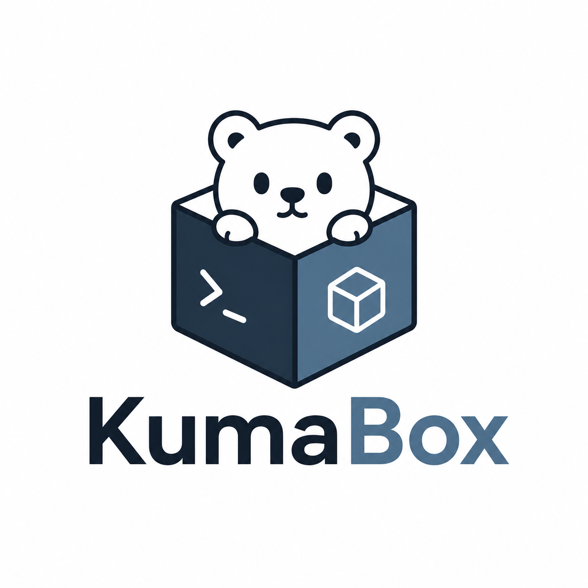

<p align="center">
  
</p>

<h1 align="center">KumaBox</h1>
<p align="center">面向 AI Agent 的 Linux microVM 运行时。</p>
<p align="center"><a href="README.md">English</a> · <b>简体中文</b></p>
<p align="center">
  <a href="https://github.com/kgpp34/KumaBox/actions/workflows/ci.yml"></a>
  <a href="LICENSE"></a>
</p>

KumaBox 基于 KVM 和 Cloud Hypervisor，在独立的 microVM 中运行 Agent 工作负载。
它通过 CLI 和 HTTP API 管理单机上的镜像、沙箱生命周期、guest 操作、网络、存储和快照。

## 核心能力

| 范围 | 已支持的操作 |
| --- | --- |
| 镜像 | 从仓库拉取，导入 Docker 归档及 OCI 目录或归档，校验、查看和删除镜像。 |
| 沙箱 | 创建、运行、启动、停止和删除，配置 CPU、内存和磁盘，查询状态与日志。 |
| Guest 操作 | 执行命令，管理后台进程，传输文件，连接控制台，转发端口。 |
| 快照 | 保存、恢复、克隆和休眠，导出和导入快照，在兼容主机之间传输。 |
| 网络 | 固定 guest 身份的 TAP/eBPF 网络与 TAP 复用，以及 CNI 和 Linux bridge 后端。 |
| 存储与设备 | 持久化可写根盘、数据盘、virtio-fs 目录共享和 VFIO PCI 设备直通。 |
| 资源控制 | cgroup、大页、KSM 和内存 balloon。 |

## 性能基准

以下为 2026 年 10 月 29–30 日归档的原生 guest 实测。宿主机为 **Xeon E3-1245 v2**，
4 核 8 线程、32 GiB 内存、SATA SSD RAID1、XFS，使用支持 mmap 恢复的 Cloud Hypervisor v54。

每台 VM 配置 2 vCPU、512 MiB 内存、10 GiB buffered 可写盘。Guest 使用原生 Rust PID 1，
网卡使用 TAP/eBPF；克隆测试配置 `machine_id_sync: false`。

从 CLI 发起操作计时，到 guest 首次成功执行 `/bin/true` 为止。
单位均为毫秒，并发场景统计每个请求的延迟。

| 操作 | 网卡数 | p50 | p95 | 样本数 |
| --- | ---: | ---: | ---: | ---: |
| 冷启动 | 0 | 239.4 | 260.6 | 30 |
| 冷启动 | 1 | 253.5 | 280.6 | 30 |
| Golden 快照克隆 | 0 | 64.1–66.4 | 69.6–70.4 | 2 × 24 |
| Golden 快照克隆 | 1 | 61.9–65.2 | 67.8–70.5 | 2 × 24 |
| 原地恢复 | 0 | 58.8 | 68.2 | 30 |
| 原地恢复 | 1 | 60.5 | 66.5 | 30 |
| 16 路并发 golden 克隆 | 0 | 260.5–268.1 | 311.8–319.8 | 2 × 96 |
| 16 路并发 golden 克隆 | 1 | 399.0–415.6 | 485.9–1105.9 | 2 × 96 |

冷启动与恢复来自 10 月 29 日，TAP 池克隆来自 10 月 30 日。区间表示两轮各自分位数的范围，
没有合并计算分位数。每轮并发测试为 6 批 × 16 个请求；第二轮带网卡测试保留了约 1.1 秒的长尾。

镜像和 golden 快照均提前准备，保留宿主机 page cache；DNS 和公网就绪不在计时终点内。
本组未使用 VM 预热池，结果对应上述构建和配置。

## 架构

CLI 通过本地 Unix socket 将操作提交给常驻的 `kumabox daemon`。常驻进程持有元数据存储，
协调资源操作并监督 VMM 进程；`kumabox serve` 提供带认证的 HTTP API。
元数据保存在本机 SQLite 中。

每个沙箱拥有独立的 guest 内核和 VMM 进程。只读 EROFS 镜像层可以共享，每个沙箱使用私有的
ext4 可写磁盘。Rust guest init 负责组装根文件系统并监督 Go agent，agent 通过 vsock
处理 guest 内的命令执行和文件操作。

[KumaBoxd](https://github.com/kgpp34/KumaBoxd) 基于此运行时管理节点本地模板、预热池和沙箱租约。

## 开始使用

运行沙箱需要 Linux、KVM（`/dev/kvm`）和 root 权限。
从 [Releases](https://github.com/kgpp34/KumaBox/releases) 下载主机工具与配套 guest 镜像。
Guest 镜像须包含兼容的启动制品和 KumaBox agent。

从源码构建需要 Go 1.24.4 或更新版本：

```bash
make build
sudo ./bin/kumabox-check --upgrade
sudo ./bin/kumabox daemon
```

保持 daemon 运行，在另一个终端导入兼容的 guest 镜像归档并创建沙箱：

```bash
sudo ./bin/kumabox image import demo-image /path/to/guest-image.tar
sudo ./bin/kumabox run demo-image --name demo --cpus 2 --memory 512MiB --nics 0
sudo ./bin/kumabox exec demo -- uname -a
sudo ./bin/kumabox snapshot save demo --name golden
sudo ./bin/kumabox clone golden --name demo-copy
```

示例使用无网卡配置。通过 `kumabox --help` 和 `kumabox COMMAND --help` 查看命令参数。
仓库提供用于服务部署的 [systemd unit](packaging/systemd/kumabox.service)；
`make guest` 可通过 Docker 构建原生 guest 镜像。

## API 与 SDK

[Python 和 TypeScript SDK](sdk/README.md) 使用版本化 HTTP API。
[E2B 适配器](internal/api/e2b/README.md) 为实验性能力，仅实现部分协议。

## 许可证

[MIT](LICENSE)
